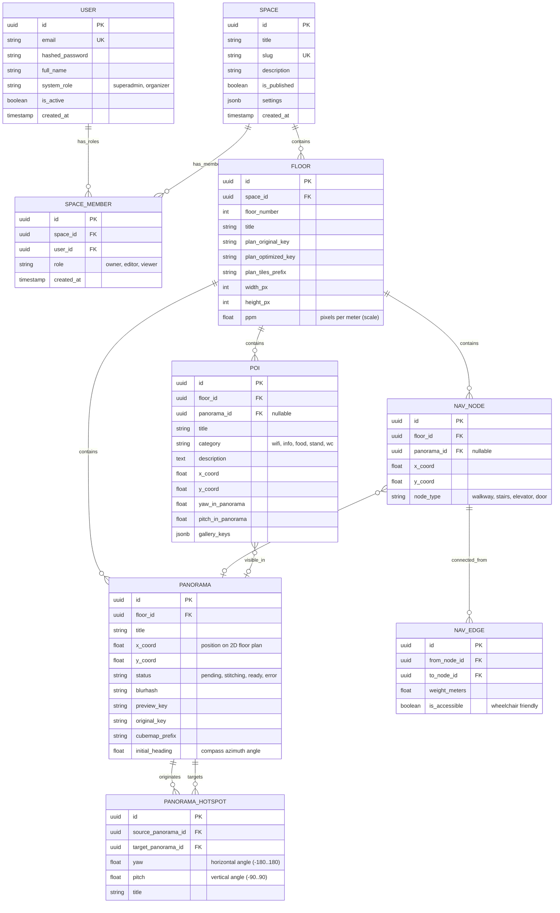
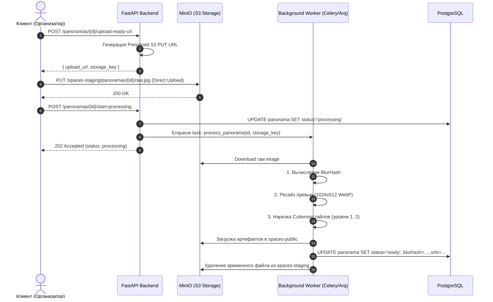

# Архитектура хранения медиа в S3 (MinIO) и Спецификация API (FastAPI + PostgreSQL)
## Проект: «Карта пространства» (ТТК)

---

## 1. Концепция и архитектура хранения медиа в S3 / MinIO

Сервис индор-навигации оперирует тяжелыми медиаданными:
1. **2D-планы этажей** (чертежи, растровые подложки высокого разрешения, тайловые карты).
2. **360° Панорамы**:
   - Исходные серии фото со смартфона (для последующей сшивки).
   - Готовые эквидистантные панорамы (Equirectangular 4K–8K).
   - Оптимизированные тайлы кубических панорам (Cubemap tiles) для быстрой отрисовки на мобильных устройствах.
   - Легковесные превью (Blurhash / Low-Res WebP) для моментального рендеринга без белого экрана.
3. **Медиа точек интереса (POI)**: фотографии стендов, залов, спикеров, логотипы.

---

### 1.1 Структура бакетов и ключей в MinIO

Рекомендуется использовать разделение на **два бакета**:
- `spaces-public`: публичные оптимизированные ассеты (доступны через CDN/Nginx с агрессивным кэшированием).
- `spaces-staging`: приватный/временный бакет для сырых фотосъёмок, исходников до обработки и сшивки.

#### Дерево объектов в S3:
```text
spaces-public/
│
└── spaces/{space_id}/
    ├── branding/
    │   ├── logo.webp
    │   └── cover.webp
    │
    ├── floors/{floor_id}/
    │   ├── plan/
    │   │   ├── original.png             # Исходный загруженный план
    │   │   ├── optimized.webp           # Оптимизированное изображение (2048px)
    │   │   ├── thumb.webp               # Превью (300px)
    │   │   └── tiles/{z}/{x}/{y}.webp   # Тайлы для Leaflet/OpenLayers (при больших чертежах)
    │   │
    │   └── pois/{poi_id}/
    │       ├── thumb.webp               # Превью 150x150
    │       └── gallery/{photo_id}.webp  # Фотографии стенда/комнаты
    │
    └── panoramas/{panorama_id}/
        ├── original.webp                # Сшитая панорама в полном разрешении (8192x4096)
        ├── preview.webp                 # Быстрое превью для мобильных (1024x512, ~80 КБ)
        ├── thumb.webp                   # Микропревью для пина на 2D-плане (200x100)
        └── cubemap/                     # Тайлы кубической панорамы (6 граней: f, b, u, d, l, r)
            ├── l1/{face}.webp           # Уровень 1 (low-res, 512x512)
            └── l2/{face}/{y}_{x}.webp   # Уровень 2 (high-res тайлы 512x512)

spaces-staging/
└── upload-sessions/{session_id}/
    ├── raw-frames/                      # Фото со смартфона для алгоритма сшивки
    │   ├── frame_001.jpg
    │   ├── frame_002.jpg
    │   └── ...
    └── status.json                      # Метаданные сессии сшивки
```

---

### 1.2 Оптимизация скорости загрузки на мобильных устройствах

Панорама в 8K в формате JPEG весит 15–30 МБ, что недопустимо для мобильного интернета в помещениях (экспоцентры, отели, подвальные этажи).

**Применяемые решения:**
1. **Прогрессивная загрузка (3-уровневая)**:
   - **Уровень 0:** Строка **BlurHash** (отдается сразу в JSON из PostgreSQL, мгновенный градиентный фон за 0 мс).
   - **Уровень 1:** `preview.webp` (1024×512, сжатие с потерями, размер 40–80 КБ, загружается за < 200 мс).
   - **Уровень 2:** Кубические тайлы (`cubemap`) или полноразмерный `original.webp` по мере вращения камеры (поддерживается библиотеками Marzipano, Pannellum, Photo-Sphere-Viewer).
2. **Direct-to-S3 Загрузка через Presigned URLs**:
   - Клиент (веб/смартфон) запрашивает у FastAPI presigned PUT URL.
   - Загружает файл напрямую в MinIO без прогона десятков мегабайт через память Python/Uvicorn.
   - По завершении отправляет сигнал в API `POST /confirm-upload`, инициируя фоновую задачу Celery / Arq / FastAPI BackgroundTasks.
3. **Кэширование и раздача**:
   - Все ссылки на оптимизированные файлы содержат хеш контента или UUID.
   - Заголовок `Cache-Control: public, max-age=31536000, immutable`.
   - Перед MinIO устанавливается Nginx Reverse Proxy с кэшированием или CDN.

---

## 2. Схема базы данных PostgreSQL

Для целостности данных медиафайлы и графы навигации хранятся в реляционной модели:



### 2.1 Детализация ролей и прав доступа (RBAC)

Система разделяет права на **два уровня**:
1. **Глобальная роль пользователя (`system_role`)**:
   - `superadmin` — системный администратор платформы (мониторинг инстанса MinIO/PostgreSQL, управление аккаунтами организаторов, блокировка пространств).
   - `organizer` — организатор мероприятий или администратор площадок/отелей (создает свои пространства, управляет тарифами/квотами).
2. **Локальная роль в пространстве (`space_members.role`)**:
   - `owner` — владелец пространства (полный доступ, удаление, добавление других администраторов).
   - `editor` — редактор карты (загрузка планов, панорам, расстановка точек POI и построение графов).
   - `viewer` — доступ к просмотру неопубликованного черновика карты (для заказчика/согласования).
3. **Посетитель (Visitor)**:
   - Не требует учетной записи (анонимный доступ к опубликованным картам по публичному URL/slug).

---

## 3. Спецификация REST API (FastAPI)

Базовый путь: `/api/v1`

### 3.1 Модуль авторизации и администрирования (Auth & Admin)

#### `POST /api/v1/auth/register`
Регистрация нового организатора площадки.
- **Request Body**:
  ```json
  {
    "email": "organizer@ttk-events.ru",
    "password": "StrongPassword123!",
    "full_name": "Иван Смирнов"
  }
  ```
- **Response** `201 Created`:
  ```json
  {
    "id": "99999999-aaaa-bbbb-cccc-dddddddddddd",
    "email": "organizer@ttk-events.ru",
    "system_role": "organizer",
    "created_at": "2026-10-23T18:00:00Z"
  }
  ```

#### `POST /api/v1/auth/login` (OAuth2 Password Flow)
Получение пары JWT токенов (Access + Refresh).
- **Request (Form Data)**:
  `username=organizer@ttk-events.ru&password=StrongPassword123!`
- **Response** `200 OK`:
  ```json
  {
    "access_token": "eyJhbGciOiJIUzI1NiIsIn...",
    "refresh_token": "eyJhbGciOiJIUzI1NiIsIn...",
    "token_type": "bearer",
    "expires_in": 3600
  }
  ```

#### `GET /api/v1/auth/me`
Получение профиля текущего пользователя и списка доступных пространств.

#### `GET /api/v1/admin/users` *(только для роли `superadmin`)*
Список всех зарегистрированных пользователей системы с пагинацией и фильтрами.

#### `PATCH /api/v1/admin/users/{user_id}/status` *(только для роли `superadmin`)*
Активация / деактивация учетной записи организатора.

#### `POST /api/v1/spaces/{space_id}/members` *(только для `owner` пространства)*
Приглашение коллеги/помощника в команду редактирования карты.
- **Request Body**:
  ```json
  {
    "email": "colleague@ttk-events.ru",
    "role": "editor"
  }
  ```

---

### 3.2 Модуль пространств (Spaces)

#### `POST /api/v1/spaces`
Создание нового пространства/мероприятия (требуется авторизация организатора).
- **Request Body**:
  ```json
  {
    "title": "IT-Конференция ТТК 2026",
    "slug": "ttk-conf-2026",
    "description": "Главный холл и выставочные стенды"
  }
  ```
- **Response** `201 Created`:
  ```json
  {
    "id": "7c9e6679-7425-40de-944b-e07fc1f90ae7",
    "title": "IT-Конференция ТТК 2026",
    "slug": "ttk-conf-2026",
    "is_published": false,
    "created_at": "2026-10-23T18:00:00Z"
  }
  ```

#### `GET /api/v1/spaces/{space_id}`
Получение детальной информации о пространстве и списка этажей.

#### `PATCH /api/v1/spaces/{space_id}/publish`
Публикация/снятие с публикации карты пространства.

---

### 3.2 Модуль этажей и 2D-планов (Floors & Plans)

#### `POST /api/v1/spaces/{space_id}/floors`
Создание этажа.
- **Request Body**:
  ```json
  {
    "floor_number": 1,
    "title": "1 этаж — Экспозона и регистрация",
    "ppm": 24.5
  }
  ```
- **Response** `201 Created`:
  ```json
  {
    "id": "11111111-2222-3333-4444-555555555555",
    "space_id": "7c9e6679-7425-40de-944b-e07fc1f90ae7",
    "floor_number": 1,
    "title": "1 этаж — Экспозона и регистрация",
    "plan_url": null
  }
  ```

#### `POST /api/v1/floors/{floor_id}/plan/upload-url`
Получение Presigned URL для загрузки 2D-плана в MinIO.
- **Request Body**:
  ```json
  {
    "file_name": "floor1_blueprint.png",
    "content_type": "image/png",
    "file_size": 8452100
  }
  ```
- **Response** `200 OK`:
  ```json
  {
    "upload_url": "https://minio.domain.local/spaces-staging/plans/11111111-2222-3333-4444-555555555555/raw.png?X-Amz-Signature=...",
    "storage_key": "plans/11111111-2222-3333-4444-555555555555/raw.png",
    "expires_in_seconds": 900
  }
  ```

#### `POST /api/v1/floors/{floor_id}/plan/confirm-upload`
Подтверждение загрузки. Запускает фоновую задачу: валидация разрешения, конвертация в WebP, генерация превью и тайлов.
- **Request Body**:
  ```json
  {
    "storage_key": "plans/11111111-2222-3333-4444-555555555555/raw.png"
  }
  ```
- **Response** `202 Accepted`:
  ```json
  {
    "status": "processing",
    "task_id": "task_plan_render_98765"
  }
  ```

---

### 3.3 Модуль панорам и виртуального тура (Panoramas)

#### `POST /api/v1/floors/{floor_id}/panoramas`
Создание точки панорамы с привязкой к координатам на 2D-плане.
- **Request Body**:
  ```json
  {
    "title": "Главный вход / Ресепшн",
    "x_coord": 350.5,
    "y_coord": 720.0,
    "initial_heading": 45.0
  }
  ```
- **Response** `201 Created`:
  ```json
  {
    "id": "bbbbbbbb-cccc-dddd-eeee-ffffffffffff",
    "floor_id": "11111111-2222-3333-4444-555555555555",
    "title": "Главный вход / Ресепшн",
    "status": "pending_upload"
  }
  ```

#### Вариант А: Загрузка готовой 360-градусной панорамы
`POST /api/v1/panoramas/{panorama_id}/upload-ready-url`
- **Request Body**:
  ```json
  {
    "file_name": "entrance_360.jpg",
    "content_type": "image/jpeg"
  }
  ```
- **Response** `200 OK`: Presigned PUT URL.

#### Вариант Б: Загрузка серии снимков со смартфона для сшивки
`POST /api/v1/panoramas/{panorama_id}/stitch-session`
- **Request Body**:
  ```json
  {
    "frame_count": 16,
    "camera_metadata": {
      "device": "iPhone 15",
      "fov": 75.0
    }
  }
  ```
- **Response** `200 OK`:
  ```json
  {
    "session_id": "sess_8912739812",
    "frames_upload_urls": [
      { "frame_index": 1, "url": "https://minio.../frame_001.jpg?sig=..." },
      { "frame_index": 2, "url": "https://minio.../frame_002.jpg?sig=..." }
    ]
  }
  ```

#### `POST /api/v1/panoramas/{panorama_id}/start-processing`
Запуск пайплайна сшивки (OpenCV / Hugin) и нарезки кубических тайлов.
- **Response** `202 Accepted`:
  ```json
  {
    "status": "queued",
    "queue_position": 1
  }
  ```

#### `GET /api/v1/panoramas/{panorama_id}/status`
Опрос статуса обработки панорамы (или WebSocket).
- **Response** `200 OK`:
  ```json
  {
    "status": "ready",
    "progress_percent": 100,
    "blurhash": "LEHLh[WB2yk8pyoJadR*.7kCMdnj",
    "preview_url": "https://cdn.domain.local/spaces-public/spaces/1/panoramas/bb/preview.webp",
    "cubemap_prefix": "https://cdn.domain.local/spaces-public/spaces/1/panoramas/bb/cubemap/"
  }
  ```

#### `POST /api/v1/panoramas/connections`
Создание перехода (Hotspot) между двумя панорамами.
- **Request Body**:
  ```json
  {
    "source_panorama_id": "bbbbbbbb-cccc-dddd-eeee-ffffffffffff",
    "target_panorama_id": "aaaaaaaa-cccc-dddd-eeee-ffffffffffff",
    "yaw": 115.4,
    "pitch": -2.1,
    "title": "Перейти в конференц-зал"
  }
  ```

---

### 3.4 Точки интереса (POI & Hotspots)

#### `POST /api/v1/floors/{floor_id}/pois`
Создание точки интереса с привязкой к 2D-карте и панораме.
- **Request Body**:
  ```json
  {
    "title": "Стенд ТТК — Цифровые сервисы",
    "category": "stand",
    "description": "Демонстрация решений для умного города и индор-навигации.",
    "x_coord": 380.0,
    "y_coord": 710.0,
    "panorama_id": "bbbbbbbb-cccc-dddd-eeee-ffffffffffff",
    "yaw_in_panorama": 45.2,
    "pitch_in_panorama": 12.0
  }
  ```

#### `POST /api/v1/pois/{poi_id}/images/upload-url`
Presigned URL для загрузки фото для галереи POI.

---

### 3.5 Маршрутизация и навигация (Navigation Graph)

#### `PUT /api/v1/floors/{floor_id}/navigation/graph`
Сохранение/обновление графа пешеходных путей для поиска маршрутов.
- **Request Body**:
  ```json
  {
    "nodes": [
      { "id": "n1", "x": 350.0, "y": 720.0, "panorama_id": "bbbbbbbb...", "type": "walkway" },
      { "id": "n2", "x": 400.0, "y": 720.0, "panorama_id": null, "type": "walkway" },
      { "id": "n3", "x": 400.0, "y": 800.0, "panorama_id": null, "type": "stairs" }
    ],
    "edges": [
      { "from_id": "n1", "to_id": "n2", "weight": 5.0, "is_accessible": true },
      { "from_id": "n2", "to_id": "n3", "weight": 8.0, "is_accessible": false }
    ]
  }
  ```

#### `POST /api/v1/spaces/{space_id}/navigation/route`
Построение оптимального маршрута между двумя точками (A* / Dijkstra).
- **Request Body**:
  ```json
  {
    "from_poi_id": "poi_1111",
    "to_poi_id": "poi_2222",
    "wheelchair_accessible_only": false
  }
  ```
- **Response** `200 OK`:
  ```json
  {
    "total_distance_meters": 45.2,
    "estimated_time_seconds": 38,
    "legs": [
      {
        "floor_id": "11111111-2222-3333-4444-555555555555",
        "floor_number": 1,
        "polyline_points": [
          [350.0, 720.0],
          [400.0, 720.0],
          [400.0, 800.0]
        ],
        "panoramas_along_path": [
          { "panorama_id": "bbbbbbbb-cccc-...", "heading_to_next": 90.0 }
        ],
        "instructions": [
          "Начните движение от главного входа",
          "Пройдите 15 метров прямо до лестницы",
          "Поднимитесь на 2 этаж"
        ]
      }
    ]
  }
  ```

---

### 3.6 Публичный API для посетителей (Public Mobile Viewer)

Оптимизирован для кэширования, высокой нагрузки и минимального размера ответа.

#### `GET /api/v1/public/spaces/{slug}`
Получение первичного пакета данных для отображения пространства.
- **Cache-Control**: `public, max-age=60`
- **Response** `200 OK`:
  ```json
  {
    "id": "7c9e6679-7425-40de-944b-e07fc1f90ae7",
    "title": "IT-Конференция ТТК 2026",
    "floors": [
      {
        "id": "11111111-2222-3333-4444-555555555555",
        "floor_number": 1,
        "title": "1 этаж",
        "plan_image_url": "https://cdn.../floors/11/plan/optimized.webp",
        "plan_thumb_url": "https://cdn.../floors/11/plan/thumb.webp",
        "width": 2048,
        "height": 1024,
        "ppm": 24.5
      }
    ],
    "categories": ["stand", "wifi", "info", "food", "wc"]
  }
  ```

#### `GET /api/v1/public/panoramas/{panorama_id}`
Получение полных данных панорамы для 3D-плеера (Pannellum / Marzipano / Three.js).
- **Response** `200 OK`:
  ```json
  {
    "id": "bbbbbbbb-cccc-dddd-eeee-ffffffffffff",
    "title": "Главный вход",
    "blurhash": "LEHLh[WB2yk8pyoJadR*.7kCMdnj",
    "preview_url": "https://cdn.../panoramas/bb/preview.webp",
    "equirectangular_url": "https://cdn.../panoramas/bb/original.webp",
    "cubemap_base_url": "https://cdn.../panoramas/bb/cubemap/{level}/{face}_{y}_{x}.webp",
    "hotspots": [
      {
        "type": "navigation",
        "target_panorama_id": "aaaaaaaa-cccc-...",
        "yaw": 115.4,
        "pitch": -2.1,
        "title": "Конференц-зал"
      },
      {
        "type": "poi",
        "poi_id": "poi_1111",
        "yaw": 45.2,
        "pitch": 12.0,
        "title": "Стенд ТТК"
      }
    ]
  }
  ```

---

## 4. Пайплайн обработки медиа (Async Worker Architecture)



---

## 5. Рекомендации по безопасности и квотам

1. **Защита доступа**:
   - Роли: `Organizer` (полный доступ к пространству по JWT), `Visitor` (только чтение публичных данных).
   - Приватность: Неопубликованные пространства (`is_published = False`) отдаются только владельцу.
2. **Ограничения загрузки (Validation)**:
   - Максимальный размер 2D-плана: 50 МБ.
   - Максимальный размер исходной 360-панорамы: 30 МБ.
   - Максимальный размер пакета серии фото для сшивки: 200 МБ (до 30 фото).
   - Белый список MIME-типов: `image/jpeg`, `image/png`, `image/webp`.
3. **Отказоустойчивость**:
   - Автоматический повтор сшивки/конвертации (до 3 попыток при сбое воркера).
   - S3 Lifecycle Rule: автоудаление неиспользованных staging-файлов старше 24 часов.

---

## 6. Эталонная реализация модели Admin / User в FastAPI (SQLAlchemy + RBAC)

```python
import enum
import uuid
from datetime import datetime
from typing import Annotated, Optional

from fastapi import Depends, HTTPException, status
from fastapi.security import OAuth2PasswordBearer
from jose import JWTError, jwt
from sqlalchemy import Boolean, DateTime, Enum, ForeignKey, String, UniqueConstraint
from sqlalchemy.dialects.postgresql import UUID
from sqlalchemy.orm import DeclarativeBase, Mapped, mapped_column, relationship

class Base(DeclarativeBase):
    pass

class SystemRole(str, enum.Enum):
    SUPERADMIN = "superadmin"
    ORGANIZER = "organizer"

class SpaceRole(str, enum.Enum):
    OWNER = "owner"
    EDITOR = "editor"
    VIEWER = "viewer"

class User(Base):
    __tablename__ = "users"

    id: Mapped[uuid.UUID] = mapped_column(UUID(as_uuid=True), primary_key=True, default=uuid.uuid4)
    email: Mapped[str] = mapped_column(String(255), unique=True, index=True, nullable=False)
    hashed_password: Mapped[str] = mapped_column(String(255), nullable=False)
    full_name: Mapped[Optional[str]] = mapped_column(String(255), nullable=True)
    system_role: Mapped[SystemRole] = mapped_column(
        Enum(SystemRole, name="system_role_enum"), default=SystemRole.ORGANIZER, nullable=False
    )
    is_active: Mapped[bool] = mapped_column(Boolean, default=True, nullable=False)
    created_at: Mapped[datetime] = mapped_column(DateTime(timezone=True), default=datetime.utcnow)

    spaces: Mapped[list["SpaceMember"]] = relationship("SpaceMember", back_populates="user", cascade="all, delete-orphan")

class SpaceMember(Base):
    __tablename__ = "space_members"
    __table_args__ = (UniqueConstraint("space_id", "user_id", name="uq_space_user"),)

    id: Mapped[uuid.UUID] = mapped_column(UUID(as_uuid=True), primary_key=True, default=uuid.uuid4)
    space_id: Mapped[uuid.UUID] = mapped_column(UUID(as_uuid=True), ForeignKey("spaces.id", ondelete="CASCADE"), nullable=False)
    user_id: Mapped[uuid.UUID] = mapped_column(UUID(as_uuid=True), ForeignKey("users.id", ondelete="CASCADE"), nullable=False)
    role: Mapped[SpaceRole] = mapped_column(Enum(SpaceRole, name="space_role_enum"), nullable=False)
    created_at: Mapped[datetime] = mapped_column(DateTime(timezone=True), default=datetime.utcnow)

    user: Mapped["User"] = relationship("User", back_populates="spaces")

# --- FastAPI Dependency (RBAC) ---
oauth2_scheme = OAuth2PasswordBearer(tokenUrl="/api/v1/auth/login")

async def get_current_user(token: Annotated[str, Depends(oauth2_scheme)]) -> User:
    try:
        payload = jwt.decode(token, "SECRET_KEY", algorithms=["HS256"])
        user_id = payload.get("sub")
        if not user_id:
            raise HTTPException(status_code=status.HTTP_401_UNAUTHORIZED, detail="Invalid token")
    except JWTError:
        raise HTTPException(status_code=status.HTTP_401_UNAUTHORIZED, detail="Token validation failed")
    
    # user = await db.get(User, uuid.UUID(user_id))
    # if not user or not user.is_active: raise 401
    return user

async def require_superadmin(user: Annotated[User, Depends(get_current_user)]) -> User:
    if user.system_role != SystemRole.SUPERADMIN:
        raise HTTPException(status_code=status.HTTP_403_FORBIDDEN, detail="Superadmin access required")
    return user
```

